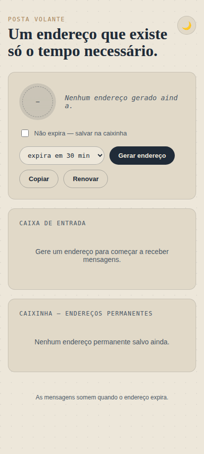
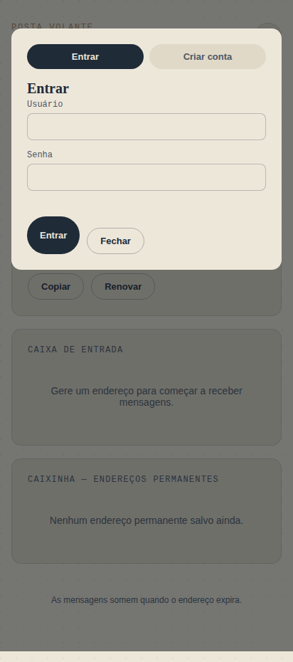
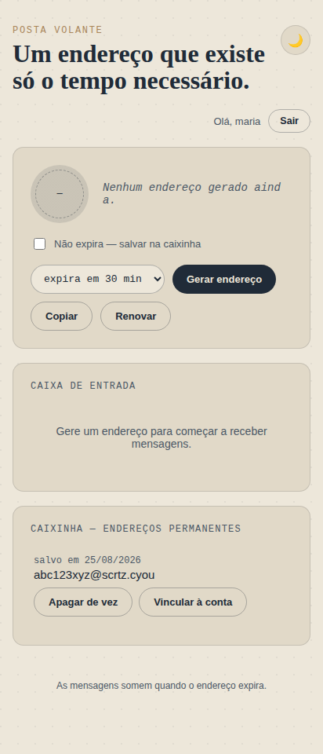

# Tutorial: do domínio zerado ao Posta Volante no ar

Esse guia parte do zero total — nem domínio você tem ainda — até o projeto rodando de verdade, recebendo e-mail. São ~30-40 minutos, a maior parte esperando DNS propagar.

Tudo aqui é **de graça** (Cloudflare free tier cobre isso inteiro) menos o domínio, que custa centavos no primeiro ano.

## O que você vai ter no final

- Um domínio seu (ex: `seunome.cyou`)
- `posvol.seunome.cyou` (ou o subdomínio que escolher) → o site, com gerador de e-mail temporário, caixa de entrada em tempo real e login opcional
- Qualquer e-mail mandado pra `qualquercoisa@seunome.cyou` aparece na hora na caixa de entrada do site
- Você com controle total: seu domínio, sua conta Cloudflare, seu banco de dados — ninguém mais tem acesso

---

## Passo 1 — Comprar o domínio (Spaceship)

Qualquer registrador serve, mas **Spaceship** costuma ter as extensões mais baratas do mercado — e `.cyou` em particular costuma ficar por menos de **US$1 no primeiro ano** (a renovação sobe pra ~US$15-16/ano depois, então se não pretende manter o mesmo domínio por anos, isso já é suficiente pra testar e usar por um bom tempo).

1. Vá em **spaceship.com** → barra de busca de domínio no topo.
2. Digita o nome que você quer (ex: `seunome`) e pesquisa.
3. Nos resultados, procura a extensão **`.cyou`** na lista — geralmente aparece bem barata, perto do topo por preço. `.cfd`, `.sbs` e `.bond` também costumam ser baratas se `.cyou` não estiver disponível pro nome que você quer.
4. Adiciona ao carrinho.
5. No checkout, a **privacidade WHOIS vem grátis** — deixa marcada (esconde seus dados pessoais do registro público do domínio).
6. Cria conta / paga (cartão ou PayPal). Vai ter uma taxa fixa da ICANN de uns US$0,20 somada no final, é normal.
7. Confirma a compra. O domínio aparece em **Manage → Domain List** na sua conta Spaceship.

> Qualquer extensão funciona igual pro resto do tutorial — `.cyou` é só a mais barata pra testar.

---

## Passo 2 — Colocar o domínio na Cloudflare

O domínio precisa estar com o DNS gerenciado pela Cloudflare — é o que permite o Email Routing e o deploy do Worker.

1. Cria uma conta grátis em **dash.cloudflare.com** (se ainda não tiver).
2. **Add a Site** → digita seu domínio novo (`seunome.cyou`) → escolhe o plano **Free**.
3. A Cloudflare escaneia os registros DNS existentes (provavelmente vazio, domínio novo) → **Continue**.
4. Ela mostra **2 nameservers** (algo como `ana.ns.cloudflare.com` e `bob.ns.cloudflare.com`) — copia os dois.
5. Volta pro **Spaceship** → Manage → seu domínio → **Nameservers** → troca de "Spaceship padrão" pros dois que a Cloudflare te deu → salva.
6. Volta na Cloudflare e clica **Done, check nameservers**.

Isso pode levar de alguns minutos até ~24h pra propagar (na prática, geralmente é rápido, menos de 1h). A Cloudflare manda um e-mail quando o domínio fica ativo.

---

## Passo 3 — Preparar as ferramentas

Precisa de [Node.js](https://nodejs.org) instalado. O resto é via terminal — **funciona igual em Windows, Mac e Linux**, já que Node e Wrangler são multiplataforma. No Windows, usa o PowerShell, CMD ou o terminal do VS Code, tanto faz.

```bash
npm install -g wrangler
wrangler login
```

Isso abre o navegador pra você autorizar o Wrangler (CLI da Cloudflare) na sua conta. Assim que autorizar, pode fechar a aba e voltar pro terminal.

Baixa/clona este repositório e entra na pasta.

---

## Passo 4 — Banco de dados (D1)

```bash
cd worker
wrangler d1 create posta-volante
```

Isso imprime um bloco parecido com:

```toml
[[d1_databases]]
binding = "DB"
database_name = "posta-volante"
database_id = "xxxxxxxx-xxxx-xxxx-xxxx-xxxxxxxxxxxx"
```

Copia esse `database_id` e cola no `worker/wrangler.toml` (substitui `COLOQUE_AQUI_O_ID_DO_SEU_D1`).

Agora roda o schema:

```bash
wrangler d1 execute posta-volante --file=./schema.sql --remote
```

---

## Passo 5 — Configurar e publicar o Worker (a API)

Abre `worker/wrangler.toml` e edita:

```toml
[vars]
MAIL_DOMAIN = "seunome.cyou"                     # o domínio que você comprou
ALLOWED_ORIGIN = "https://posvol.seunome.cyou"   # o endereço do site — mesmo que ainda não exista, usa o que você planeja (passo 7)
RETENTION_HOURS = "24"
```

Instala as dependências e define o segredo de autenticação:

```bash
npm install
wrangler secret put AUTH_SECRET
```

Quando ele pedir, cola qualquer string longa e aleatória. É o que assina os tokens de login — guarda em local seguro, mas não precisa decorar. Pra gerar uma (funciona igual no Windows, Mac ou Linux, já que usa o Node que você acabou de instalar):

```bash
node -e "console.log(require('crypto').randomBytes(32).toString('hex'))"
```

Publica:

```bash
wrangler deploy
```

No final ele imprime a URL do seu Worker, algo como:

```
https://posta-volante-worker.SEU-SUBDOMINIO.workers.dev
```

**Copia essa URL** — é o `API_BASE` que o front-end vai usar no próximo passo.

---

## Passo 6 — Email Routing (fazer o e-mail chegar de verdade)

No painel da Cloudflare, dentro do seu domínio:

1. Menu lateral → **Email** → **Email Routing**.
2. Clica em **Get started** / **Enable Email Routing** — a Cloudflare adiciona os registros MX e TXT necessários sozinha.
3. Vai em **Routing rules** (ou **Rotas**) → aba **Catch-all**.
4. Configura o catch-all: **Action** = `Send to a Worker`, seleciona `posta-volante-worker` (o Worker do passo 5).
5. Salva e deixa a regra **Active**.

A partir daqui, qualquer e-mail mandado pra `qualquercoisa@seunome.cyou` vai direto pro `email()` handler do Worker.

---

## Passo 7 — Front-end: configurar e publicar

Abre `frontend/index.html`, procura a linha `API_BASE` (bem no topo do `<script>`) e troca pela URL do Worker do passo 5:

```js
const API_BASE = "https://posta-volante-worker.SEU-SUBDOMINIO.workers.dev";
```

Publica o site como um segundo Worker (só de arquivos estáticos — é o jeito atual recomendado pela Cloudflare, sem precisar de Pages nem GitHub):

```bash
cd ../frontend
wrangler deploy
```

Isso sobe usando o `frontend/wrangler.toml` (já incluso no repositório) e te dá uma URL tipo `https://posta-volante-site.SEU-SUBDOMINIO.workers.dev`. Funciona, mas o ideal é ter um endereço bonito no seu domínio:

1. No painel Cloudflare → **Workers & Pages** → clica no worker `posta-volante-site`.
2. **Settings** → **Domains & Routes** → **Add** → **Custom Domain**.
3. Digita `posvol.seunome.cyou` (ou o subdomínio que preferir) → **Add Domain**.

A Cloudflare cria o registro DNS sozinha. Em poucos minutos, `https://posvol.seunome.cyou` já é o site.

---

## Passo 8 — Fechar o CORS

Se no passo 5 você colocou o `ALLOWED_ORIGIN` provisório, confere se ele bate com a URL final do site (`https://posvol.seunome.cyou`). Se mudou, edita `worker/wrangler.toml` e roda `wrangler deploy` de novo dentro de `worker/`.

---

## Passo 9 — Testando (como o resultado final deve ficar)

1. Abre `https://posvol.seunome.cyou`. Deve aparecer a tela abaixo, sem o banner de aviso vermelho (se aparecer, o `API_BASE` ainda não foi trocado):

   

2. Clica **Gerar endereço** (deixa em "expira em 30 min" pra testar). Um endereço tipo `ab12cd34ef@seunome.cyou` aparece.
3. De outro e-mail (Gmail, Outlook, o que tiver), manda uma mensagem de teste pra esse endereço.
4. Em até alguns segundos, a mensagem aparece sozinha na **Caixa de entrada** do site (ele faz polling automático).
5. Testa o login: clica **Entrar** → **Criar conta** → cria um usuário.

   

6. Gera um endereço com **"Não expira"** marcado — ele já nasce vinculado à sua conta.

   

7. Sai (**Sair**) e entra de novo — o endereço permanente deve continuar aparecendo na Caixinha, puxado automaticamente da sua conta.

Se todos esses passos funcionaram, o deploy está completo e correto.

---

## Problemas comuns

| Sintoma | Causa provável |
|---|---|
| Banner vermelho no topo do site | `API_BASE` no `frontend/index.html` ainda é o placeholder — volta no Passo 7 |
| Erro de CORS no console do navegador | `ALLOWED_ORIGIN` no worker não bate com a URL real do site — Passo 8 |
| E-mail de teste nunca chega | Regra catch-all não está `Active`, ou aponta pro worker errado — revê o Passo 6. DNS do domínio também precisa estar totalmente ativo na Cloudflare (Passo 2) |
| Login dá erro 401/500 | Esqueceu de rodar `wrangler secret put AUTH_SECRET` — Passo 5 |
| `wrangler deploy` reclama de `database_id` | Esqueceu de colar o ID do D1 no `worker/wrangler.toml` — Passo 4 |

---

Dúvidas de arquitetura, variáveis de ambiente e limitações do projeto: veja o [`README.md`](README.md).
